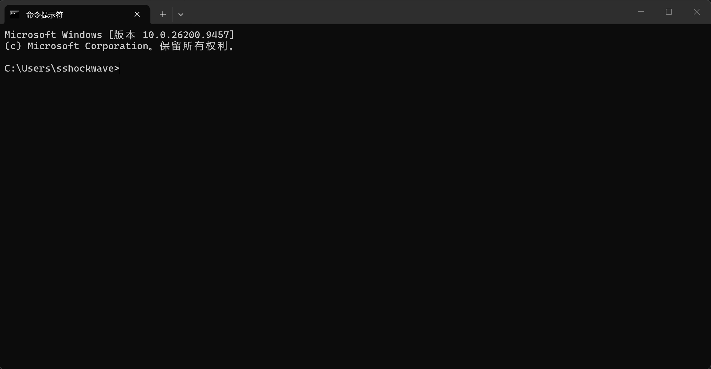
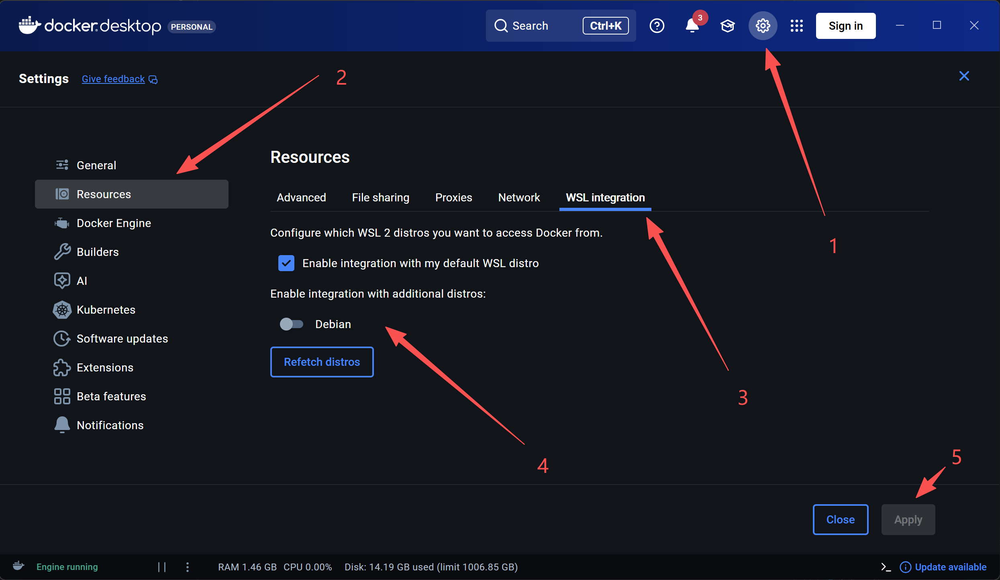

# Devcontainers 安装步骤

步骤：

- 按win键，输入`cmd`，回车打开
    
- 输入`wsl --install`，等待安装完成。WSL是Docker需要的组件。
- 安装Docker Windows
    - 可以选择在Microsoft Store中安装：[链接](https://apps.microsoft.com/detail/xp8cbj40xlbwkx)
    - 或使用我们下载的安装包：[链接](https://cloud.tsinghua.edu.cn/d/8928c3deb4d6424a8bea/)
- 启动后，点击设置，对所有distro启用WSL integration:
    
- 在VSCode中打开某个项目文件夹，创建`.devcontainer/devcontainer.json`，内容如下：
    ```json
    {
        "image": "mcr.microsoft.com/devcontainers/cpp:debian"
    }
    ```
- 安装[Dev Containers](https://marketplace.visualstudio.com/items?itemName=ms-vscode-remote.remote-containers)插件
- 点击VSCode页面左下角按钮，选择“Reopen in Container”，等待下载安装完成
    - 如果提示需要安装docker，在确认Docker引擎已开启的状态下，重启VSCode并重试
- 应该能看到文件夹已重新打开。推荐的VSCode插件：
    - [C/C++ Extension Pack](https://marketplace.visualstudio.com/items?itemName=ms-vscode.cpptools-extension-pack) C/C++语法智能提示
    - [C/C++ Compile Run](https://marketplace.visualstudio.com/items?itemName=danielpinto8zz6.c-cpp-compile-run) 一键编译/调试/运行单C/C++文件
